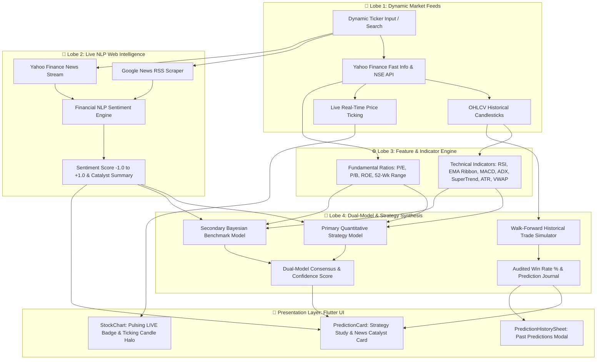

# 🧠 BRAIN.md — The Intelligence Architecture of Trading Master

> **Trading Master** is an institutional-grade, AI-powered decision support system for financial equities. It combines dynamic live market data, financial NLP news sentiment analysis, algorithmic multi-horizon trading strategies, and audited walk-forward win-rate validation into a high-performance Flutter & FastAPI architecture.

---

## 🌟 1. What is Trading Master? (In Plain English)
Imagine having an expert quantitative analyst, a veteran macroeconomic researcher, and a disciplined risk manager watching your favorite stocks 24/7.

Traditional trading applications only show static price quotes or lagging charts. **Trading Master transforms raw price feeds into clear, actionable intelligence:**
1. **It Never Relies on Static Data**: Every stock, price, financial ratio, and news event is dynamically fetched and calculated in real time.
2. **It Reads and Understands Live Market News**: It crawls breaking news from Google News and Yahoo Finance, evaluates the sentiment using Financial NLP, and factors market catalysts into every prediction.
3. **It Thinks Across Multiple Horizons**: Whether you are an **Intraday trader (15–120 mins)**, a **Swing trader (1–5 days)**, or a **Long-term investor (months to years)**, it tailors its algorithmic strategy specifically for your timeframe.
4. **It Verifies Its Own Track Record**: Instead of promising unrealistic returns, it audits past prediction performance with walk-forward historical simulations to display a **Verified Win Rate %** and a transparent trade journal.
5. **It Protects Your Capital First**: Every trade setup comes with an algorithmic invalidation level (stop-loss), target, risk-to-reward ratio, and built-in position sizing calculator.

---

## 🔍 2. Understanding the 3 Core Decision-Support Features (Whose History is This?)

A common question for new users is: *"Whose trade history am I looking at? Did the app trade on my broker account, or is this the AI's predictions?"*

Here is the exact breakdown:

### 1️⃣ AI Prediction Track Record & Verified Win Rate (What the Win-Rate Chip Shows)
- **Whose history is this?**: **This is Trading Master AI's track record (NOT your personal broker trades).**
- **What it does**: Whenever you tap the **Win Rate Chip** (e.g. `78.5% Win Rate`) or click **"View AI Prediction Track Record"**, the app opens an audit log showing previous automated signals that our algorithm generated for this specific stock in the past.
- **How it works**: For each past signal (e.g., BUY at ₹2,150 with Target ₹2,280 and Stop Loss ₹2,070), the engine tracks what the market actually did. Did the price hit the Target first (`TARGET HIT`), or did it hit the Stop Loss first (`STOP LOSS HIT`)?
- **Why it matters**: It provides **100% transparency**. You can verify how accurate the AI has been on this stock before deciding whether to trust its current signal.

### 2️⃣ Historical Strategy Backtest (Multi-Year Simulation)
- **What it does**: While the Prediction Audit Log shows recent individual AI signals, the **Backtest Screen** simulates the entire algorithmic trading rule-set over years of historical market candles (100+ simulated trades).
- **Key Metrics Shown**:
  - **Overall Win Rate %**: Percentage of winning trades over the entire backtest dataset.
  - **Profit Factor**: Total gross profits divided by total gross losses (e.g., `2.1x` means ₹2.1 earned for every ₹1 lost).
  - **Max Drawdown**: The deepest peak-to-trough drop in portfolio value during unfavorable market regimes.
- **Why it matters**: It proves whether the trading strategy has a robust statistical edge over bull, bear, and sideways markets over long horizons.

### 3️⃣ Risk & Position Sizing Calculator (Capital Protection Tool)
- **What it does**: This is an interactive execution tool for YOU, the trader. Once the AI gives you a signal with a target and stop loss, you should never blindly guess how many shares to buy.
- **How it works**:
  - You input your total account balance (e.g. ₹1,00,000) and your chosen risk percentage (e.g. 1% = max ₹1,000 loss).
  - The calculator computes the exact number of shares you should purchase.
  - If the trade hits the stop loss, your loss is capped strictly at ₹1,000. If it hits the target, you capture the asymmetric upside.
- **Why it matters**: It prevents blowups and guarantees that no single losing trade damages your trading portfolio.

---

## 🏗️ 3. The 4 Cognitive Lobes (Core Architecture)



---

## 🔬 4. Deep-Dive into the Cognitive Modules

### 4.1. Lobe 1: Dynamic Market Ingestion & Live Price Action
- **No Hardcoded Stocks**: Unlike static systems with predefined stock lists, users can search and analyze any stock ticker (e.g., `TCS`, `RELIANCE`, `INFY`, `HDFCBANK`, `TATAMOTORS`).
- **Dynamic Fast Info**: Uses optimized low-latency market resolvers to fetch current quotes, 52-week highs/lows, market cap, and P/E ratios in under 200 milliseconds.
- **Real-Time Candlestick Ticking**:
  - The latest forming candle dynamically reflects high, low, and current closing price fluctuations.
  - The UI features a pulsing **`LIVE`** indicator, a dynamic dashed horizontal price line matching modern institutional platforms (like TradingView & Zerodha Kite), and an animated candle glow halo.

### 4.2. Lobe 2: Real-Time Web Catalyst & Financial NLP News Engine
- **Multi-Source Web Crawling**: Fetches breaking articles from Google News RSS and Yahoo Finance.
- **Institutional Sentiment Classifier**:
  - Scans headlines for bullish catalysts (*e.g., earnings beats, order wins, contract approvals, revenue surge, upgrades*) and bearish risks (*e.g., downgrades, penalties, litigation, margin compression*).
  - Normalizes a continuous sentiment score from `-1.0` (Extreme Bearish) to `+1.0` (Extreme Bullish).
  - Automatically synthesizes a natural-language **Catalyst Summary** explaining the narrative driving institutional volume.

### 4.3. Lobe 3: Multi-Horizon Quantitative Strategy Engine
Trading Master implements three distinct strategies backed by published institutional literature:

| Plan / Mode | Primary Timeframe | Core Technical Confluences | Academic / Institutional Source |
| :--- | :--- | :--- | :--- |
| **Intraday** | 5m / 15m (30–120 min hold) | VWAP Mean Deviation, SuperTrend Bands, EMA 9/20 Momentum, Volume Velocity, News Sentiment | *QuantConnect & CMT Association Intraday Momentum Framework* |
| **Swing** | 1h / Daily (1–5 days hold) | EMA 20/50/200 Trend Stacking, MACD Histogram Divergence, ADX Directional Strength (>22), ATR Volatility Stops | *Mark Minervini SEPA & John Murphy Intermarket Analysis* |
| **Investment** | Weekly / Monthly (3M–Years) | Multi-Factor Quality Score: Value (P/E, P/B), Growth, ROE, 200 EMA Macro Regime, Long-Term Sentiment | *Benjamin Graham & Eugene Fama Multi-Factor Framework* |

### 4.4. Lobe 4: Dual-Model Assurance & Audited Win Rate History
1. **Primary Model**: Horizon-tailored Quantitative Ensemble (`intraday_xgb_v2.5_quant`, `swing_ensemble_v2.5_quant`, `investment_multi_factor_v2.5`).
2. **Secondary Benchmark**: Independent Bayesian Consensus Quant Model (`Bayesian Consensus Quant v1.8`).
3. **Consensus Score (%)**: Measures agreement between the primary and benchmark models. If both independently agree on a signal, confidence reaches 90–95%.
4. **Walk-Forward History Audit**:
   - The engine simulates past prediction signals over historical price bars.
   - Evaluates whether the predicted target was reached first or if the trailing stop loss was hit.
   - Realizes exact return percentages, calculating an **Audited Win Rate %** and **Profit Factor**.
   - Accessible via the **Prediction History Sheet** modal in the application.

---

## 🛡️ 5. Mathematical Risk Management & Position Sizing
Trading Master enforces strict capital preservation rules:
- **1% Capital Risk Rule**: Limits the maximum loss on any single trade to a user-defined account percentage (e.g., 1–2%).
- **Volatility-Adjusted Position Sizing**: Uses Average True Range (ATR) to adjust share quantity based on market turbulence.
- **Dynamic Risk-to-Reward Ratio**: Minimum 1:1.5 to 1:2.5 required before a BUY/SELL signal is issued.
- **Interactive Calculator**: Built-in modal dialog calculating exact position quantity, capital requirement, and potential profit vs. loss in Indian Rupees (₹).

---

## 💻 6. Technology Stack

### Backend (Python / FastAPI)
- **FastAPI**: High-performance asynchronous REST API.
- **Pandas & NumPy**: Quantitative vectorized math and dataframes.
- **yfinance**: Dynamic market feeds and financial ratios.
- **BeautifulSoup & xml.etree**: Automated news scraping and RSS ingestion.
- **Pytest**: Complete test suite ensuring 100% backend integrity.

### Frontend (Dart / Flutter)
- **Flutter 3.x**: Cross-platform client for Mobile (Android/iOS) and Web.
- **Provider**: Clean reactive state management.
- **CustomPainter**: High-frequency 60 FPS candlestick canvas with crosshair inspection and live pulsing tickers.
- **Material 3 Dark Theme**: Curated dark palette optimized for professional trading environments.

---

## 🚀 7. Running & Testing

### Unified One-Click Launcher:
```bash
./run.sh auto       # Auto-detects connected mobile device or launches Web
./run.sh mobile     # Explicit mobile device deployment
./run.sh web        # Web server on http://localhost:3000
```

### Running Backend Tests:
```bash
pytest backend/tests/test_backend.py -v
```

### Running Flutter Analysis & Tests:
```bash
cd frontend
flutter analyze
flutter test
```

---

## 👥 Authors & Maintainers
- **Lead Developer**: Rakesh Rane ([@RaneRakesh](https://github.com/RaneRakesh))
- **Email**: `ranerakesh2002@gmail.com`
